# Vulnerability management in LCore

---


Pavel Tišnovský,
ptisnovs@redhat.com

---

&bdquo;Do You Control Your Dependencies Or Are They Controlling You?&ldquo;

---

## Requirements

* LCore published on PyPI
* Images based on UBI
* Images published on catalog.redhat.com
* Images published on Quay.io

---

## Problems

* UBI is not minimal anymore
    - many packages and many CVEs
* Many Python dependencies
* Image Health index degrades over time
    - quickly under the new policy
* [Example](https://catalog.redhat.com/en/software/containers/lightspeed-core/lightspeed-stack-rhel9/69149c6590bc83e678940a63#security)

---

## Direct vs transitive dependencies

```
$ uv pip list | wc -l
284

$ uv tree | wc -l

Resolved 322 packages in 2ms
649
```

---

## Current state (LCore)

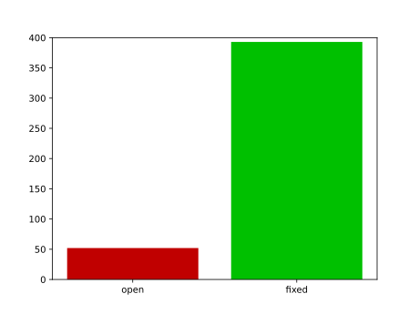

---

## Severities

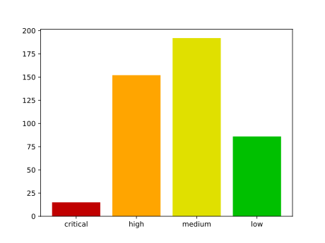

---

## Days to resolve CVE

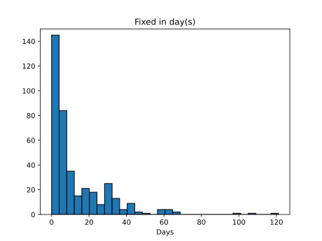

---

## Packages with most CVEs

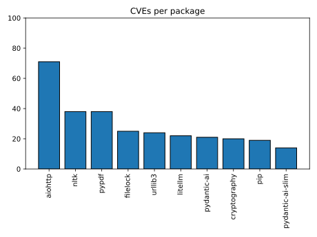

---

## New CVEs over time

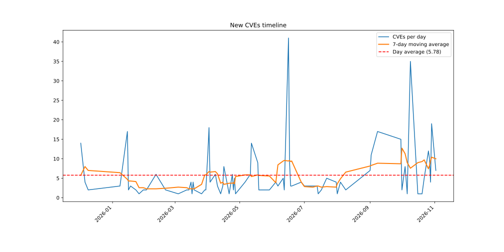

---

## Not just LCore!

* providers
* rag-content (tool)

---

## Current state (Rag content)

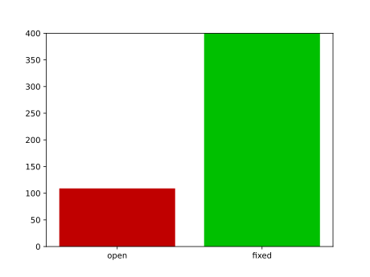

---

## Severities

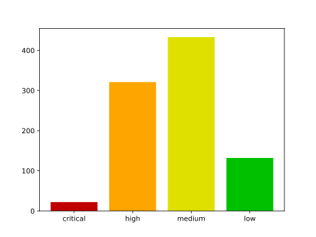

---

## Days to resolve CVE

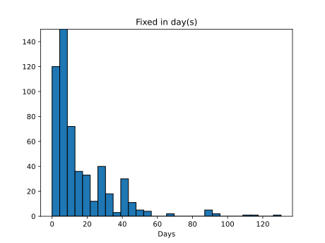

---

## Packages with most CVEs

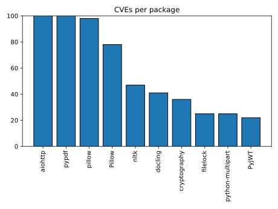

---

## New CVEs over time

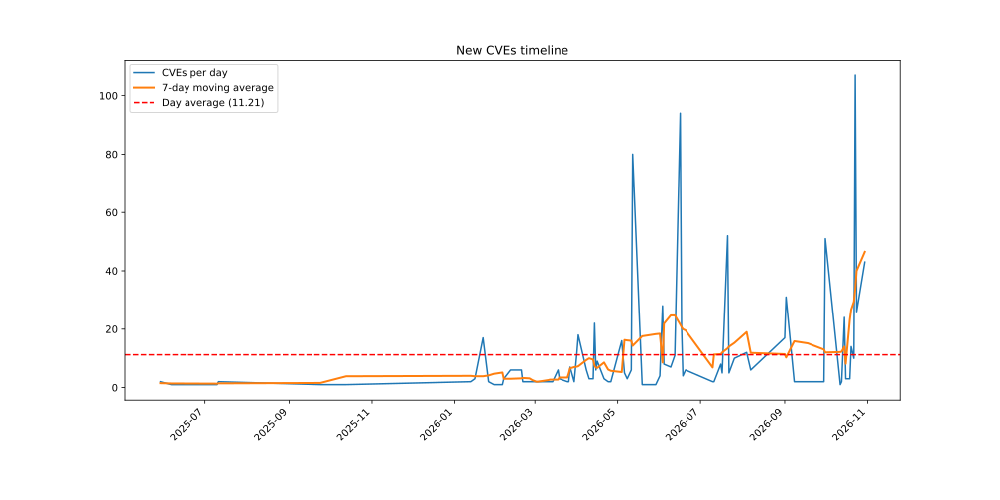

---

## CVE fixes

* pyproject.toml + uv.lock
* requirements.txt used by Konflux
    - public packages
    - RHOAI packages

---

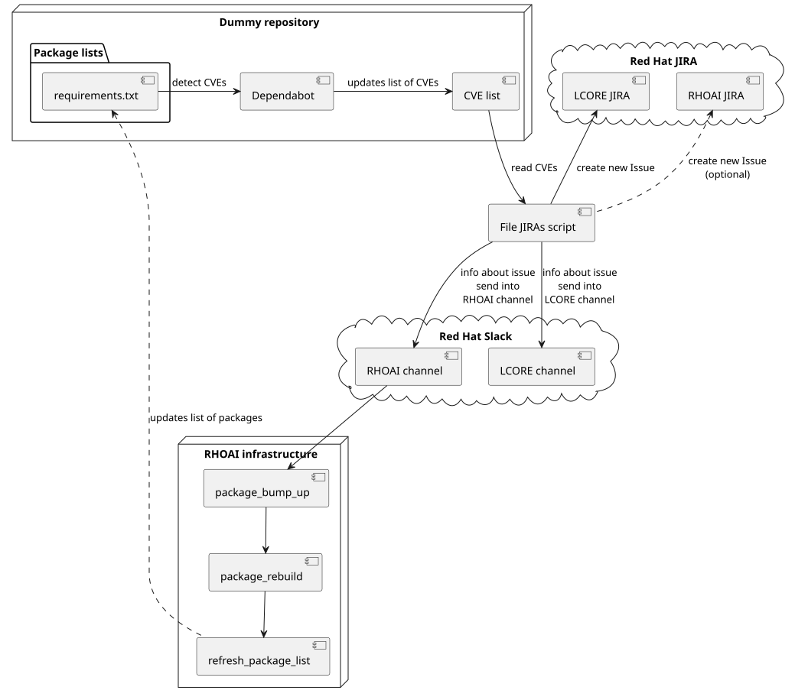

---

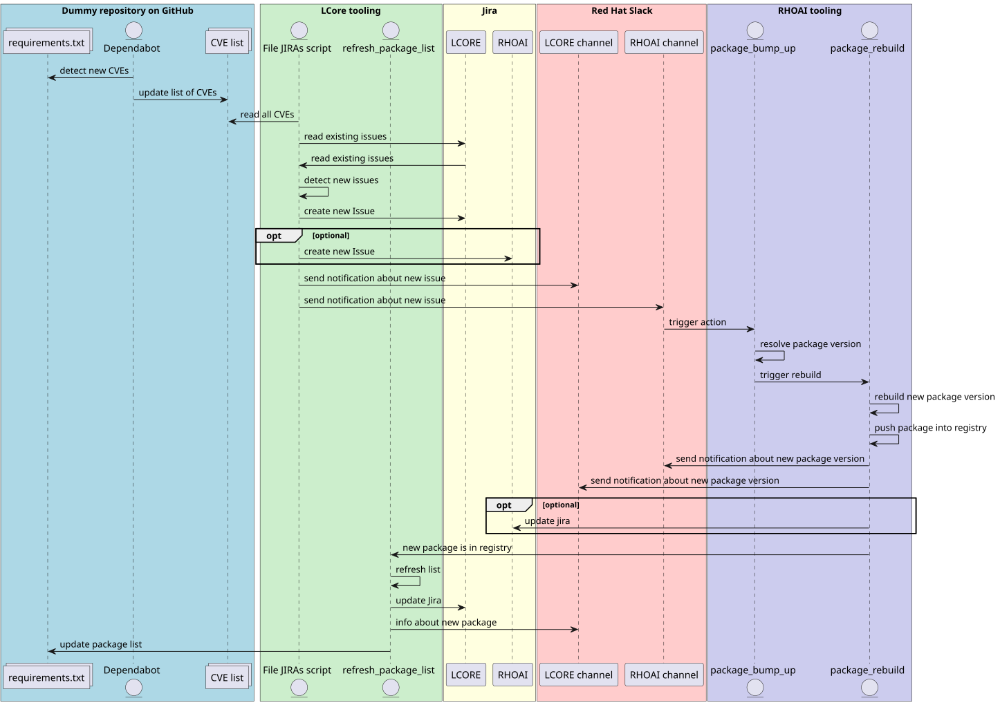

---

## Cost for every fix (PR)

* Fullsend
    - Effort: high · Cost: $2.84 - $4.28

---

## Thank you

