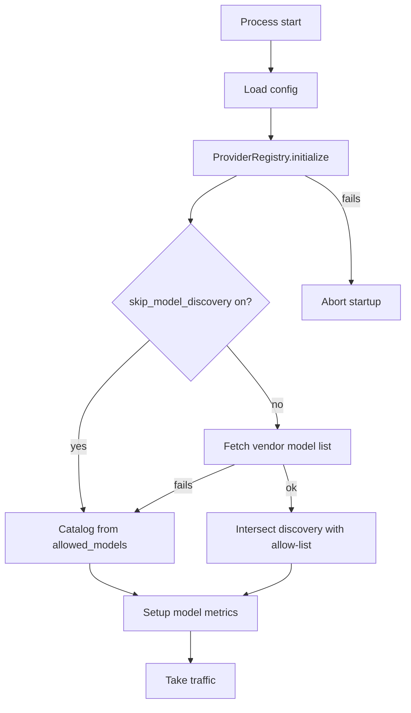

# Catalog and Health Endpoints Migration

|                          |                                                                                   |
|--------------------------|-----------------------------------------------------------------------------------|
| **Date**                 | 2026-10-08                                                                        |
| **Component**            | lightspeed-stack                                                                  |
| **Authors**              | Andrej Šimurka                                                                    |
| **Feature / Initiative** | [UIESTRAT-216](https://redhat.atlassian.net/browse/UIESTRAT-216)                  |
| **Spike**                | [LCORE-4290](https://redhat.atlassian.net/browse/LCORE-4290)                      |
| **Links**                | Investigation: [pai-catalog-health-endpoints.docx](https://docs.google.com/document/d/1rQRCGqkaai4ZH1mS6Png7Bf_pnH3H4_GOas9NseyXwA/edit?tab=t.0#heading=h.syvklt5v8yrk) |

## 1. Overview

LCORE exposes catalog and health endpoints that tell callers which inference surfaces are available and whether the process can take traffic. Today those behaviors depend on OGX: `/v1/providers` proxies its plugin inventory, `/v1/tools` uses that inventory for file-search discovery, `/v1/info` reports an OGX version, and `/v1/readiness` checks whether the sidecar is reachable and can serve the default model.

As part of the PAI migration, OGX is removed from the stack. Inference moves in-process, so there is no remote plugin list, backend version, or sidecar health surface for these endpoints to query.

PAI will replace OGX for vendor communication. It constructs models in-process through LCORE’s [provider registry](pai-providers-registry.md), but it does not provide catalog or probe HTTP APIs, and it has no equivalent of degraded mode.

LCORE will therefore own these surfaces directly. It removes the provider inventory, keeps tools, info, and liveness as LCORE-owned endpoints, and redefines readiness as a local check that the provider registry is initialized and the configured default model exists. Failures in vendors and optional services remain request-level errors rather than readiness or degraded-mode conditions.

This document is the architecture for LCORE’s catalog and health endpoints after OGX removal. It describes how OGX supports these endpoints today, what changes with in-process PAI inference, and how each catalog and health surface is treated after OGX removal.

---

## 2. Background

This section describes how each catalog and health endpoint uses OGX today, and what changes when OGX is gone.

### 2.1 What OGX does today

`GET /v1/providers` and `GET /v1/providers/{id}` proxy OGX `providers.list()` and `providers.retrieve()`. They return OGX’s plugin inventory grouped by API type (inference, tool runtime, vector io, etc.). Query, Responses, Inference endpoints do not use this API. Its only internal consumers are the readiness health walk and file-search discovery for `/v1/tools`.

`GET /v1/tools` lists MCP and agent-capability tools from LCORE configuration, then calls OGX `providers.list()` to see whether a file-search plugin is present. If it is, LCORE appends a static builtin file-search catalog; the tool definitions are not fetched from OGX. The response tells callers which tools the agent can use.

`GET /v1/info` calls OGX `inspect.version()` to populate `ogx_version` and combines it with LCORE `name` and `service_version`. The call fails if OGX is unavailable, so the endpoint reports both LCORE identity and sidecar presence.

`GET /liveness` does not call OGX. It returns `alive: true` to show that the process is up.

`GET /readiness` depends on OGX reachability. Startup connects to OGX; if that fails, `allow_degraded_mode` can admit traffic with `overall_status=degraded`. The probe lists plugins through OGX `providers.list()`, using each plugin’s health status, and checks the default model through OGX `openai.list()`, with a library reload as a self-heal. The result tells Kubernetes whether the process can serve inference, or is degraded because the sidecar is down.

### 2.2 What changes with OGX gone

Inference runs in-process through LCORE’s provider registry. There is no sidecar plugin inventory, no `inspect.version()`, and no remote health surface to query.

PAI replaces OGX for vendor communication. It constructs models locally, but it does not provide `/v1/providers`, `/v1/tools`, `/v1/info`, or Kubernetes probes, and it has no equivalent of degraded mode. Default-model availability becomes a local registry check rather than a remote plugin health check.

---

## 3. Final design at a glance

| Endpoint                        | Action                                                      |
| ------------------------------- | ----------------------------------------------------------- |
| `GET /v1/providers` (+ `/{id}`) | **Remove**                                                  |
| `GET /v1/tools`                 | **Keep** — MCP + capabilities; remove OGX dependency        |
| `GET /v1/info`                  | **Keep** — `name` + `service_version`; remove `ogx_version` |
| `GET /liveness`                 | **Unchanged**                                               |
| `GET /readiness`                | **Rewrite** — local `ProviderRegistry` + default model      |

The inference catalog remains `GET /v1/models`. MCP and file search are always on; they are not configurable provider inventory rows (`model-context-protocol`, `inline::file-search`) anymore.

The startup flow initializes the local provider registry. When `skip_model_discovery` is on, the catalog is taken from `allowed_models` and the process becomes ready. When skip is off, LCORE fetches the vendor model list; if that fetch fails, startup continues as if skip were on (catalog from `allowed_models`). A successful fetch intersects discovery with the allow-list. No degraded-mode fallback is needed.

---

## 4. Detailed design

### 4.1 Remove `GET /v1/providers`

No replacement. Inference identity is available through `provider_id` on `/v1/models`; MCP and file search belong to their respective LCORE surfaces, not provider inventory rows.

Remove the endpoint, related auth actions, response models, and tests. Do not rebuild a multi-API inventory.

### 4.2 Keep `GET /v1/tools`

Keep MCP tools and skills tools with the existing response shape. Remove OGX-backed file-search discovery; file-search catalog entries belong to the [RAG & Vector Stores Migration](https://redhat.atlassian.net/browse/UIESTRAT-215) feature.

### 4.3 Keep `GET /v1/info`

Return `name` and `service_version` only. Remove `ogx_version` and regenerate OpenAPI. Do not substitute a PAI or library version.

### 4.4 Keep `GET /liveness` unchanged

Continue returning `alive: true`. Liveness checks whether the process is up; readiness determines whether it can serve inference.

### 4.5 Rewrite `GET /readiness`

**Remove OGX-dependent readiness and degraded mode.** Startup no longer connects to OGX, walks provider health, or reloads the library to recover default-model availability.

**Readiness means the [providers registry](pai-providers-registry.md) is usable.**

* **Startup:** Load config and initialize `ProviderRegistry`. If `skip_model_discovery` is on, build the catalog from `allowed_models` and continue. If skip is off, fetch the vendor model list; on failure, continue as if skip were on (same `allowed_models` catalog). On success, intersect discovery with the allow-list. Then configure model metrics.
* **Probe:** Check that the registry is initialized and the configured default model exists locally in the cached catalog. No network calls.
* **Healthy:** HTTP 200, `ready: true`, `overall_status: healthy`, `providers: [...]`.
* **Unhealthy:** HTTP 503, `ready: false`, `overall_status: unhealthy`; identify the failing default inference provider when applicable.
* **No default model configured:** Skip the default-model check; readiness depends only on the registry being initialized.

Keep the existing response shape (`ready`, `reason`, `overall_status`, `impacts`, `providers`), but remove `HealthStatus.DEGRADED`.

A failed vendor model-list call at startup does not abort or mark the pod unready; it falls back to the skip path above. Ongoing vendor reachability, MCP, vector stores, file search, and the optional conversation database are not readiness checks—their failures remain request-level errors.

Delete the sidecar-era degraded-mode machinery: `degraded_mode.py`, `allow_degraded_mode`, `ls_started_in_degraded_mode`, the metric, startup branch, readiness early return, and related documentation.

### 4.6 Alternative designs

Several alternatives were considered and rejected:

* **Rebuild `/v1/providers`:** Duplicates `/v1/models` and invents inventory rows for MCP and file search.
* **Keep degraded mode for vendor outages:** Conflates sidecar availability with request-level inference failures.
* **Ping vendors or optional services from readiness:** Adds network dependency and couples traffic admission to unrelated subsystems.
* **Keep `ogx_version` as a PAI version:** Misrepresents LCORE service information; `service_version` is sufficient.
